# Diagramas y pantallazos de la sesión 1

Todos los diagramas son código Graphviz (`diagramas/*.dot`) y se regeneran con:

```bash
bash docs/diagramas/render.sh     # PNG a 200 dpi en diagramas/png, SVG en diagramas/svg
```

## Arquitectura

### El laboratorio del curso
Cada estudiante trabaja en una VM Ubuntu con Docker. Las apps vulnerables escuchan solo en `127.0.0.1`. Demo 1.

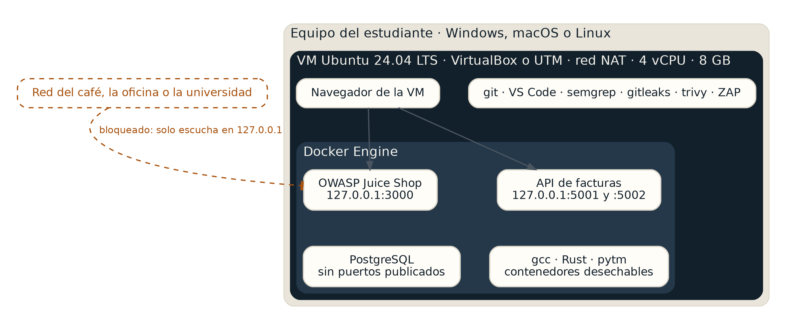

### La API de facturas de las demos
Dos versiones de la misma API y un servicio de permisos, levantados con `demos/sesion-1/03-api/docker-compose.yml`. Demos 3 y 5.

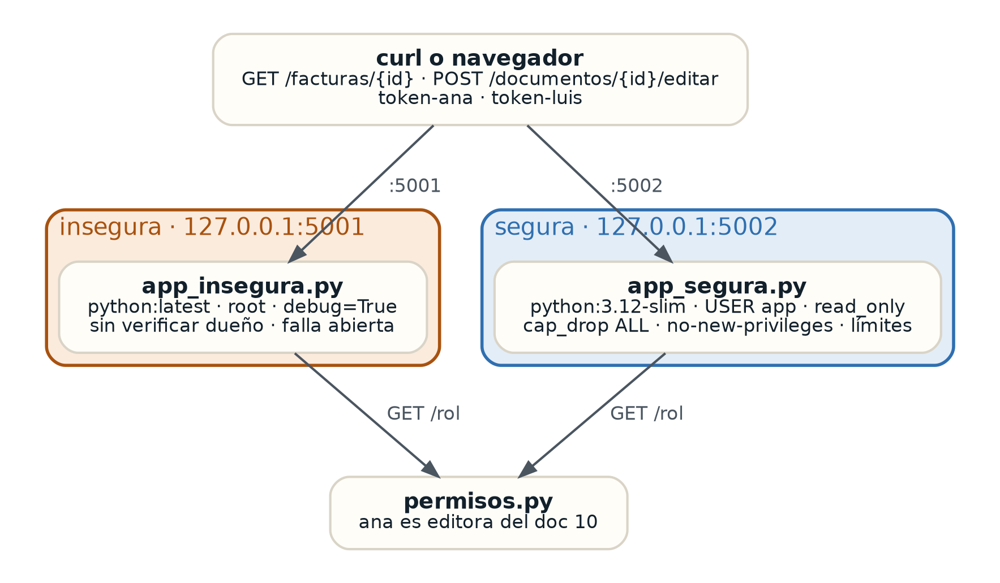

### Diagrama de flujo de datos generado con pytm
Generado desde `demos/sesion-1/08-modelo-amenazas/modelo.py`. Las líneas punteadas rojas son límites de confianza. Demo 8.

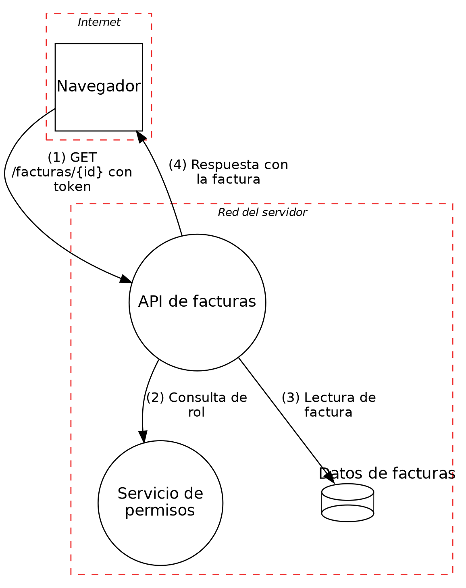

## Ciclo de vida de desarrollo seguro

Cada fase con su práctica del NIST SSDF y la sesión del curso donde se trabaja.

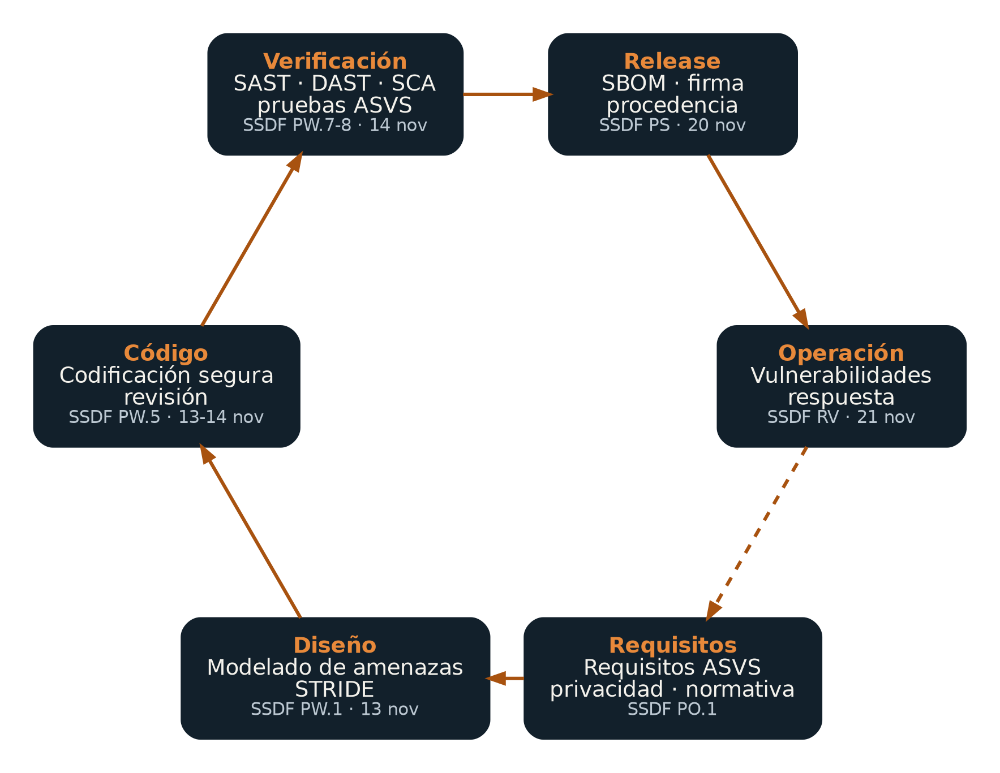

## Principios, paso a paso

### Mediación completa (demo 3A)
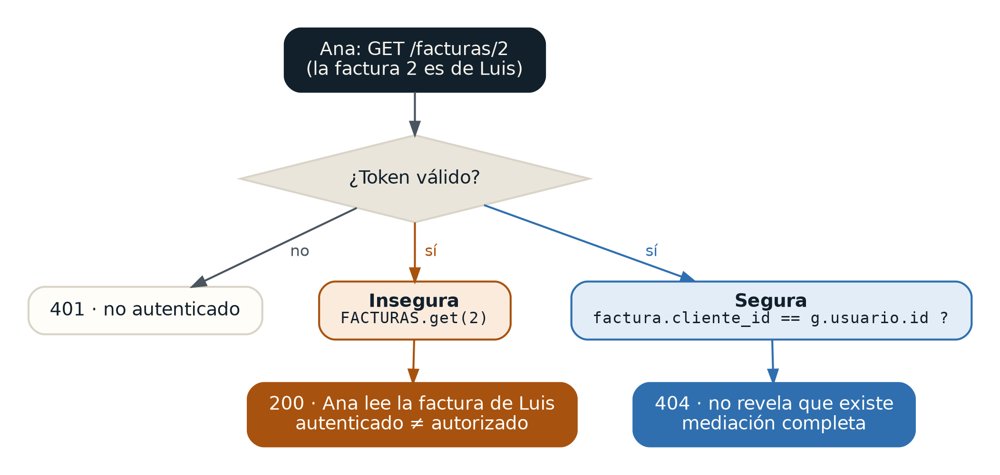

### Fallar de forma segura (demo 3B)
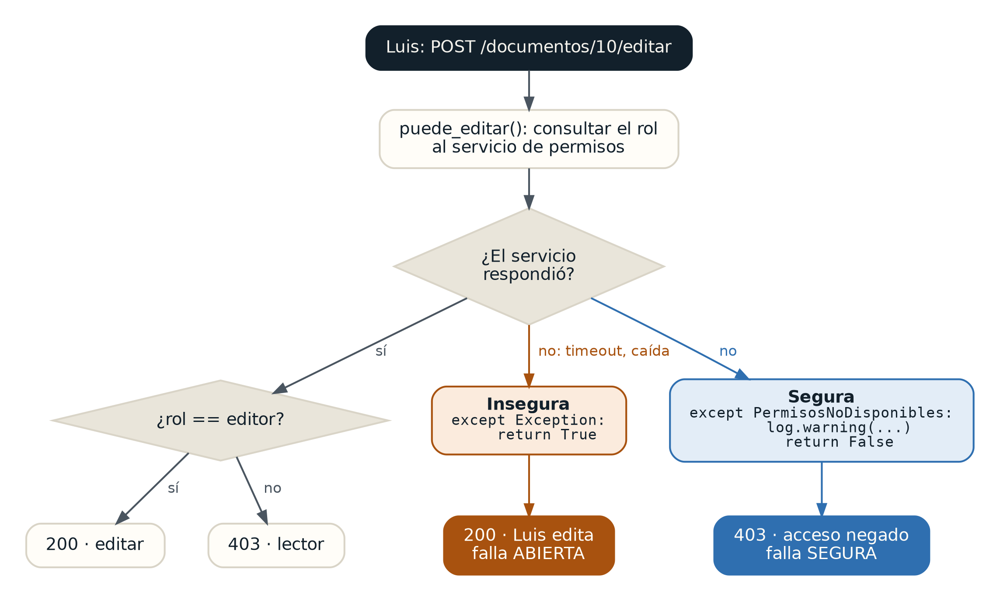

### Mínimo privilegio en la base de datos (demo 4)
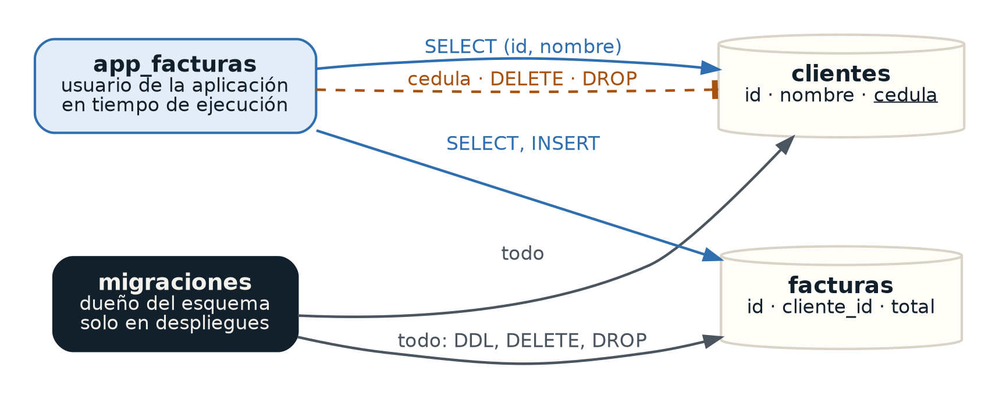

### Defensa en profundidad (demo 5)
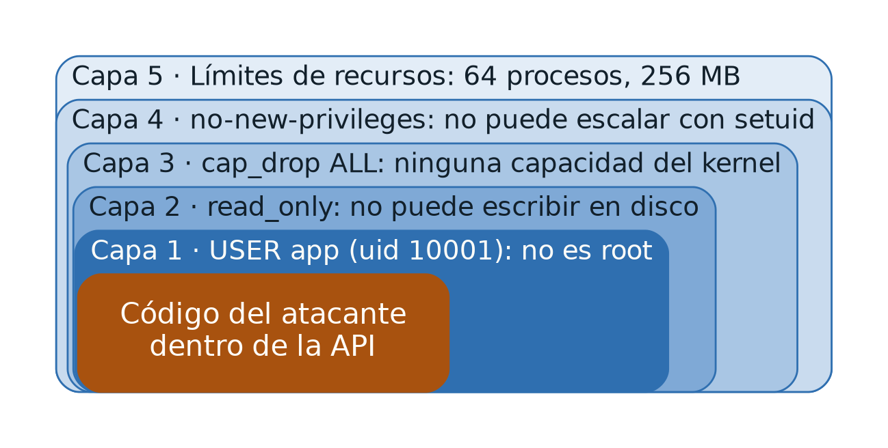

### Seguridad de memoria (demo 6)
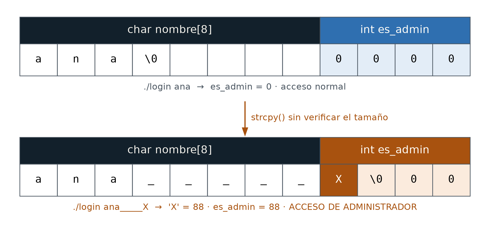

## Casos reales

### Log4Shell (2021) · cadena del incidente y controles
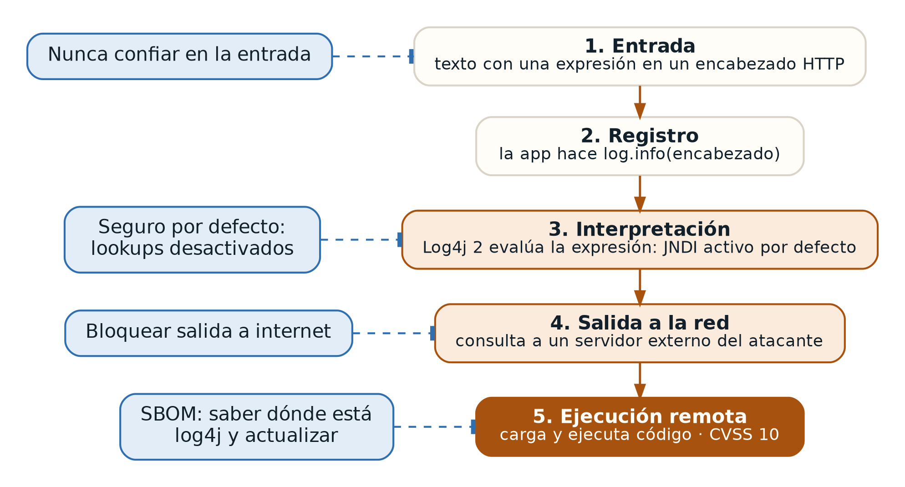

### xz utils (2024) · lo publicado no es lo revisado (demo 2)
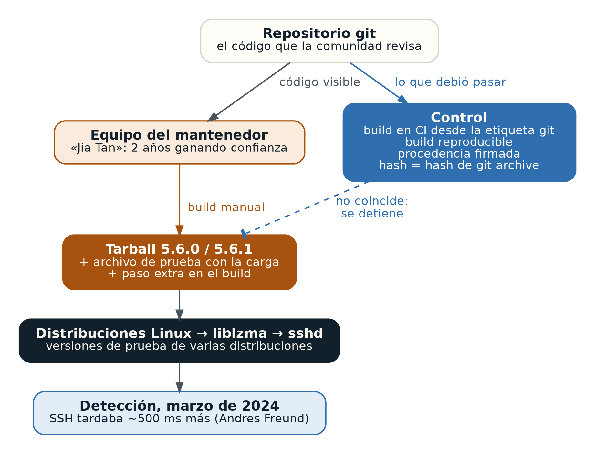

### Shai-Hulud (2025) · un gusano en npm
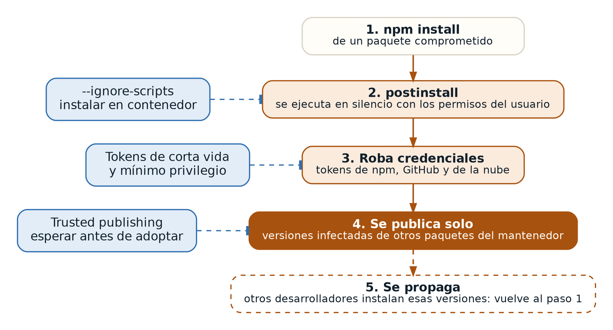

## Pantallazos

| Archivo | Qué muestra |
|---|---|
| [`pantallazos/juice-shop.png`](pantallazos/juice-shop.png) | OWASP Juice Shop corriendo en `127.0.0.1:3000` dentro del laboratorio |
| [`pantallazos/api-insegura-error.png`](pantallazos/api-insegura-error.png) | La API insegura con `debug=True`: traza completa, rutas internas, versión de Python y consola de ejecución de código |
| [`pantallazos/api-segura-error.png`](pantallazos/api-segura-error.png) | La API segura ante el mismo error: mensaje genérico |
